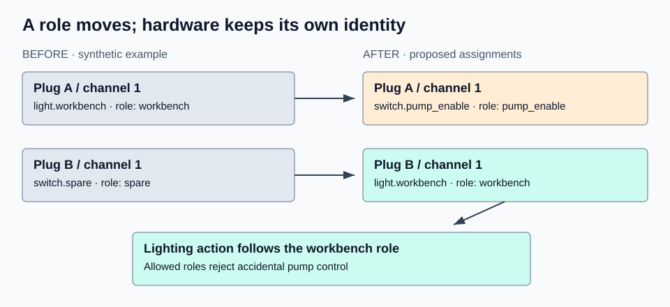

# Home Assistant Entity Migrations

**Move a logical role to new hardware without silently moving its old automation to the wrong appliance.** This offline Python CLI produces a reviewable plan from an explicit inventory and consumer policies. It never connects to Home Assistant or applies a change.

[Русский](README.ru.md) · [Deutsch](README.de.md) · [Español](README.es.md) · [English guide](docs/en/installation.md) · [Wiki source](wiki/Home.md)



A plug once powered a workbench lamp and will now power a pump. The **light role** moves to a different plug. `follows_role` keeps the lighting automation attached to the lamp; `follows_hardware` follows the physical channel, but its allowed-role guard rejects the new pump role. `retire` removes an explicitly selected consumer container. Diagnostics can stay with the physical device. This is a semantic plan, not search-and-replace.

## Install and try

Requires Python 3.11 or newer; runtime dependencies: none. From a source checkout:

```sh
python3 -m venv .venv
. .venv/bin/activate
python3 -m pip install -e .
ha-entity-migrations --lang en plan --manifest examples/role-swap/manifest.json --snapshot examples/role-swap/snapshot.json --root examples/role-swap
```

The example is entirely synthetic. It returns a `ready` JSON report and exit 0. Its lighting reference stays `light.workbench`, whose declared hardware changes, while an obsolete spare automation is marked for removal. No files or devices are modified.

Try `examples/domain-change` with the same arguments: the plan changes `light.table` to `switch.table` and `light.turn_off` to `switch.turn_off`. `examples/blocked-template` instead returns `blocked`, exit 3. Put `--lang en|ru|de|es` before the command; `--format text` after `plan` gives a human-readable report. Machine keys/codes remain language independent.

## Scope of the first release

- Strict JSON manifest and normalized snapshot with device/channel/role and declared capabilities.
- Exact JSON pointers into JSON configuration. Fingerprints cover the exact input bytes.
- Explicit consumer policies, required capabilities and allowed roles.
- Conservative light/switch service conversion for a single literal target without action data.
- Unresolved Jinja, indirect targets, unmodeled references, unsupported formats and card feature changes block the plan.
- Deterministic JSON report, stable diagnostic codes, no credential requirement or network client.

`ready` only means the supplied declarations and supported file scope passed these checks. It is not a complete audit of HA, a statement that the declarations match the hardware, or physical acceptance. YAML input is reported as unsupported, not parsed with unsafe tags or silently ignored. Normalize it explicitly to JSON and review that representation; this tool does not preserve YAML comments, anchors or formatting.

## Documentation

1. [Installation and CLI](docs/en/installation.md)
2. [Input model and schema](docs/en/model.md)
3. [Worked examples](docs/en/examples.md)
4. [Architecture and report contract](docs/en/architecture.md)
5. [Troubleshooting](docs/en/troubleshooting.md)
6. [Limitations and safe review](docs/en/limitations.md)
7. [Sources](docs/sources.md), [security](SECURITY.md), [contributing](CONTRIBUTING.md), [changelog](CHANGELOG.md)

The checked-in [wiki pages](wiki/Home.md) are documentation source; their presence does not claim a hosted GitHub wiki has been published.

## Development

```sh
PYTHONPATH=src python3 -m unittest discover -s tests -v
python3 tools/generate_examples.py
python3 tools/render_diagrams.py
```

Tests cover role repurposing, domain migration, collisions, stale fingerprints, unresolved inputs, bounded parsing and all four CLI languages. They do not connect to a household or prove that any device switches. The three SVGs are original reproducible synthetic diagrams, not measured performance charts or photographs.

MIT licensed. Project/package version: **0.1.0**.
