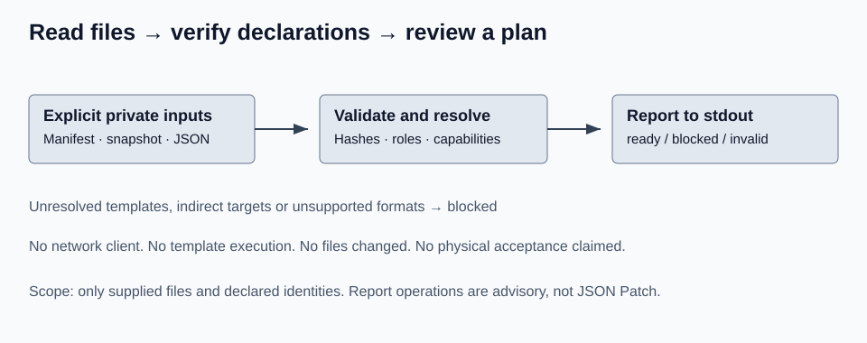
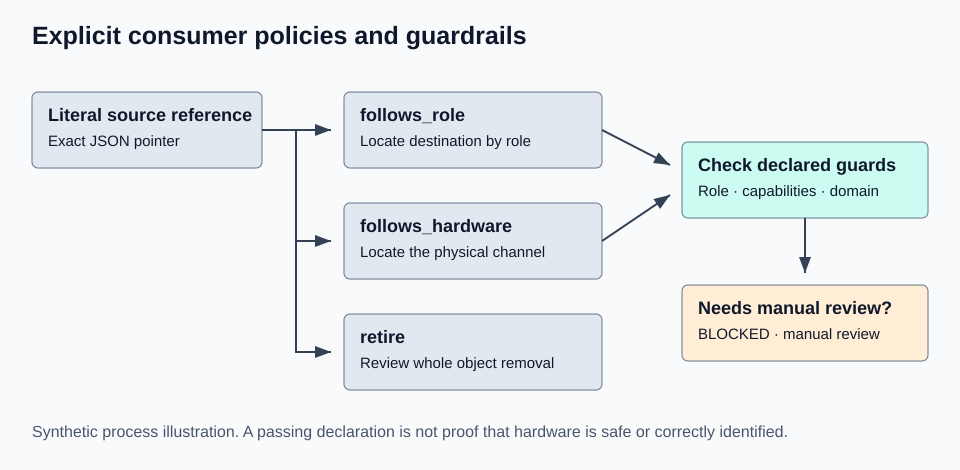

# 架构与报告契约

<!-- language-navigation:start -->

<a href="../en/architecture.md" lang="en" dir="ltr">English</a> ·
<a href="../ar/architecture.md" lang="ar" dir="rtl">العربية</a> ·
<a href="../bn/architecture.md" lang="bn" dir="ltr">বাংলা</a> ·
<a href="../cs/architecture.md" lang="cs" dir="ltr">Čeština</a> ·
<a href="../de/architecture.md" lang="de" dir="ltr">Deutsch</a> ·
<a href="../es/architecture.md" lang="es" dir="ltr">Español</a> ·
<a href="../fa/architecture.md" lang="fa" dir="rtl">فارسی</a> ·
<a href="../fr/architecture.md" lang="fr" dir="ltr">Français</a> ·
<a href="../he/architecture.md" lang="he" dir="rtl">עברית</a> ·
<a href="../hi/architecture.md" lang="hi" dir="ltr">हिन्दी</a> ·
<a href="../id/architecture.md" lang="id" dir="ltr">Bahasa Indonesia</a> ·
<a href="../it/architecture.md" lang="it" dir="ltr">Italiano</a> ·
<a href="../ja/architecture.md" lang="ja" dir="ltr">日本語</a> ·
<a href="../ko/architecture.md" lang="ko" dir="ltr">한국어</a> ·
<a href="../nl/architecture.md" lang="nl" dir="ltr">Nederlands</a> ·
<a href="../pl/architecture.md" lang="pl" dir="ltr">Polski</a> ·
<a href="../pt/architecture.md" lang="pt" dir="ltr">Português</a> ·
<a href="../ru/architecture.md" lang="ru" dir="ltr">Русский</a> ·
<a href="../th/architecture.md" lang="th" dir="ltr">ไทย</a> ·
<a href="../tr/architecture.md" lang="tr" dir="ltr">Türkçe</a> ·
<a href="../uk/architecture.md" lang="uk" dir="ltr">Українська</a> ·
<a href="../vi/architecture.md" lang="vi" dir="ltr">Tiếng Việt</a> ·
<a href="../zh-Hans/architecture.md" lang="zh-Hans" dir="ltr">简体中文</a> ·
<a href="../zh-Hant/architecture.md" lang="zh-Hant" dir="ltr">繁體中文</a>

<!-- language-navigation:end -->

[模型](model.md) · [限制](limitations.md)

`io.py` 强制执行文件、路径和 JSON 限制，并处理精确指针。`planner.py` 验证声明，构建变更前后映射，扫描源值，解析显式策略并收集诊断记录。`cli.py` 添加翻译后的消息并输出报告。`i18n.py` 包含四套完整消息目录。此路径不依赖网络或 Home Assistant。

扫描器刻意采取保守方式。精确的实体引用字符串会与快照核对。含嵌入引用的字符串仍为未解决状态。键或值中的模板，以及设备、区域、标签目标键，即使看似容易推断，也仍为未解决状态。普通服务字段不当作实体 ID；动态服务仍为未解决状态。非 JSON 文件被登记为不支持的来源并阻止规划。这不是通用 HA 解析器。

## 稳定的 JSON 外层结构，模式版本 1

`schema_version`、`tool_version`、`status`、`read_only`、`scope`、`snapshot_sha256`、`source_sha256`、`assignments`、`edits`、`diagnostics`、`language`、`summary`。有效输入的 `status` 为 ready 或 blocked。`scope` 始终为 `supplied_files_only`；`read_only` 始终为 true。输入错误使用安装指南说明的较小 invalid 外层结构。

编辑项包含操作、文件和指针。`replace_reference` 还包含 before/after/policy；`replace_service` 包含 before/after；`remove_consumer` 包含要停用的引用。这些**不是可执行的 JSON Patch**，缺少事务、索引移动及 HA 生命周期语义。请将它们视为建议进行审查；此版本有意不提供补丁应用器。

诊断包含稳定的 `code`、`location`、`severity` 以及翻译后的 `message`。`error` 和 `unresolved` 都会阻止计划。`blocked` 报告可能包含不受影响引用的候选编辑，但这些都不是可直接执行的事务。过期或冲突的初始模型会抑制全部候选引用编辑。分配项始终回显用户请求的模型，不表示已完成的变更。

为便于复现，报告会排序来源、分配、编辑和诊断。没有当前时间戳或凭空生成的置信分数。字节哈希证明分析了哪个输入版本，不证明输入真实，也不证明设备会服从命令。
